# ProjectNexus

**Platform Team-Matching & Inkubator Proyek Kolaborasi Lintas Keahlian Siswa**

Prototipe aplikasi mobile berbasis Flutter yang membantu siswa membentuk tim proyek lintas keahlian, dengan guru pendamping yang meninjau setiap ide proyek sebelum rekrutmen anggota dibuka.

| | |
|---|---|
| Mata kuliah | Mobile Programming (UTS – Proyek Mandiri) |
| Pengembang | Ryan Anggara Deki – 2413025074 – PTI 2024B |
| Program studi | Pendidikan Teknologi Informasi, Universitas Lampung |
| Platform | Flutter 3.47 (Dart 3.13), target Android dan web |

## Latar belakang

Siswa yang ingin ikut lomba atau membuat proyek sering kesulitan menemukan rekan dengan keahlian yang saling melengkapi. Tim biasanya dibentuk dari teman dekat sehingga keahliannya seragam, dan ide proyek belum tentu didampingi guru. ProjectNexus mempertemukan pemilik ide dengan siswa lain berdasarkan keahlian, mewajibkan persetujuan guru pendamping sebelum proyek dipublikasikan, dan menyediakan ruang kerja tim.

## Fitur utama

| Fitur | Keterangan |
|---|---|
| Login dua peran | Siswa masuk dengan email, NIM, atau username; guru dengan email sekolah. Siswa baru dapat mendaftar akun. |
| Pengajuan proyek | Siswa mengajukan draf proyek dan memilih guru pendamping. Draf berstatus *menunggu tinjauan*. |
| Persetujuan guru (ACC) | Hanya guru yang dipilih yang dapat menyetujui atau menolak draf disertai masukan. Siswa dapat merevisi lalu mengirim ulang. |
| Feed rekrutmen | Hanya proyek yang disetujui dan rekrutmennya terbuka yang tampil. Tersedia pencarian dan filter keahlian. |
| Rekomendasi & ramah pemula | Feed diurutkan berdasarkan kecocokan keahlian, minat, dan waktu luang. Proyek pemula diberi label, langkah pertama, dan perkiraan jam per minggu. |
| Lamaran & seleksi anggota | Siswa melamar sekali per proyek. Ketua menerima atau menolak pelamar dan dapat menutup rekrutmen. Jumlah anggota tidak dibatasi. |
| Workspace tim | Papan tugas To-Do, In Progress, dan Done yang hanya dapat dibuka anggota tim dan guru pendamping. |
| Portofolio & lencana | Tugas yang selesai tercatat otomatis sebagai kontribusi dan diberi lencana apresiasi. |
| Katalog prestasi & profil | Etalase prestasi sekolah serta profil yang dapat diedit (keahlian, minat, waktu luang). |

## Tangkapan layar

<table>
  <tr>
    <td align="center">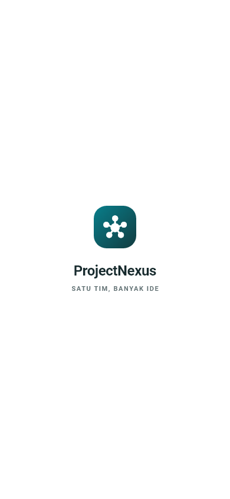<br>Splash</td>
    <td align="center">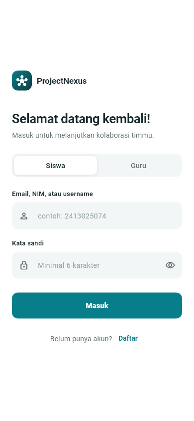<br>Login</td>
    <td align="center">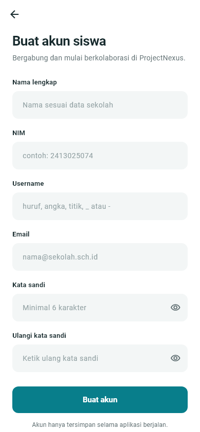<br>Registrasi siswa</td>
    <td align="center">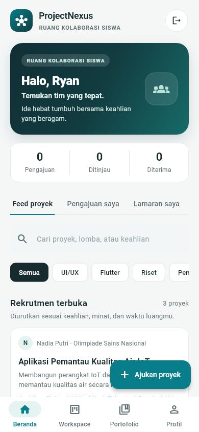<br>Beranda siswa</td>
  </tr>
  <tr>
    <td align="center">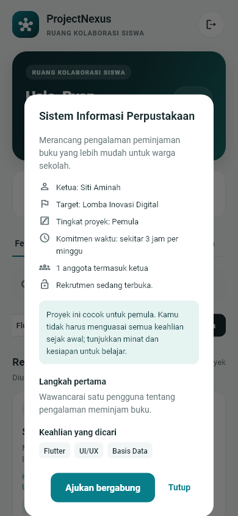<br>Detail proyek</td>
    <td align="center">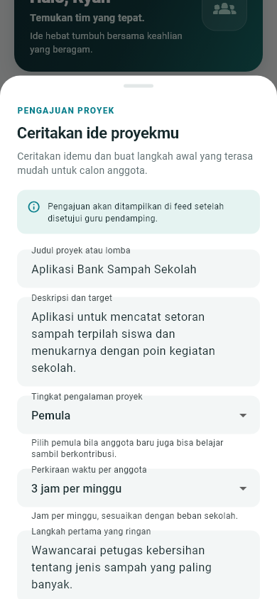<br>Ajukan proyek</td>
    <td align="center">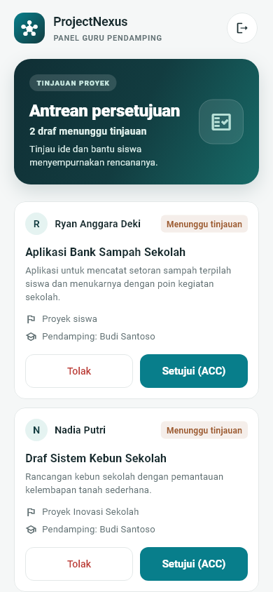<br>Antrean guru</td>
    <td align="center">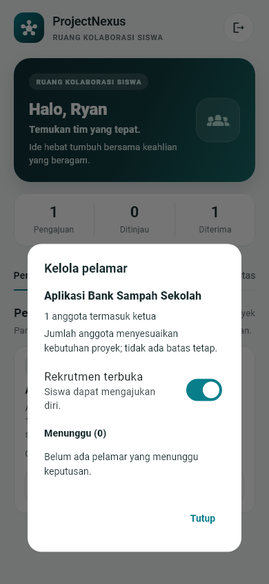<br>Kelola pelamar</td>
  </tr>
  <tr>
    <td align="center">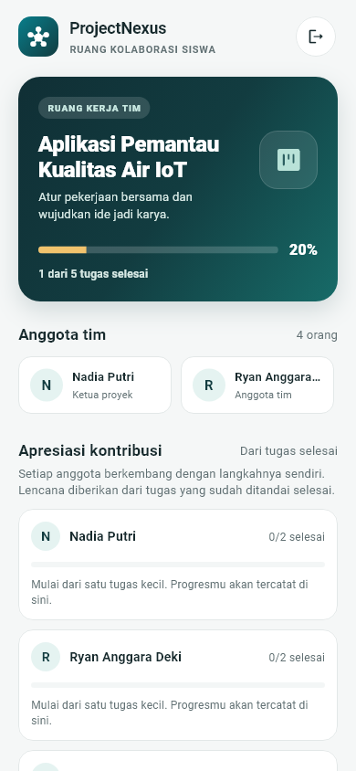<br>Workspace</td>
    <td align="center">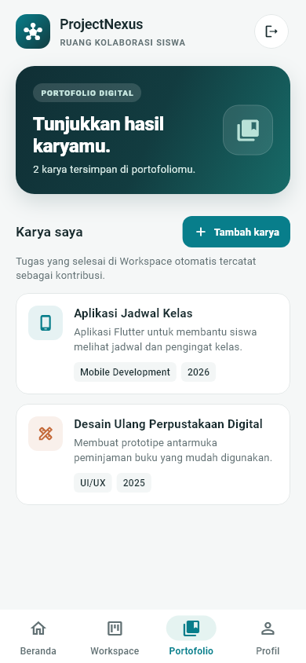<br>Portofolio</td>
    <td align="center">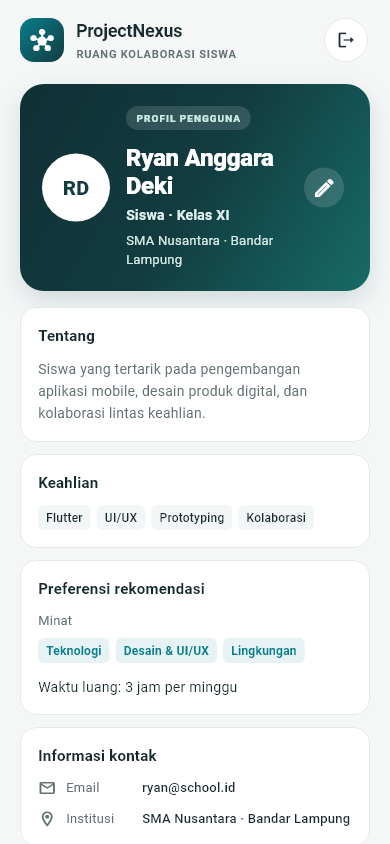<br>Profil</td>
    <td></td>
  </tr>
</table>

Tampilan pada layar lebar (navigasi samping):

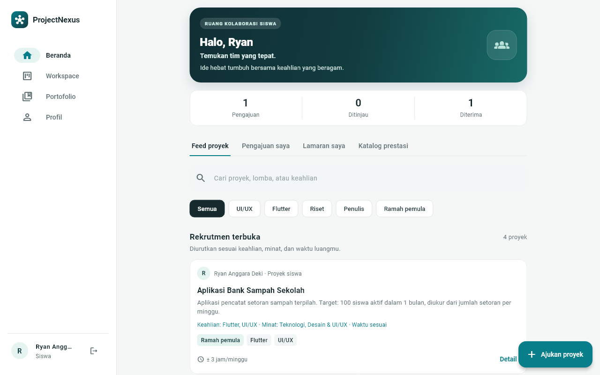

## Teknologi

- **Flutter** dan **Dart** dengan widget Material 3
- **ChangeNotifier** untuk state alur proyek dan lamaran (`ProjectWorkflowStore`)
- **shared_preferences** untuk sesi login dan preferensi rekomendasi
- **flutter_test** untuk unit test dan widget test

## Struktur proyek

```
lib/
├── main.dart                     # titik masuk aplikasi
├── core/theme/                   # warna dan tema terpusat (AppTheme)
└── features/
    ├── auth/                     # splash, login, registrasi, sesi (AuthGate)
    │   ├── models/  screens/  widgets/
    └── dashboard/                # beranda, workspace, portofolio, profil
        ├── data/                 # data contoh dan penyimpanan preferensi
        ├── models/               # model, aturan alur proyek, rekomendasi
        ├── screens/
        └── widgets/
test/                             # 12 unit test dan 21 widget test
docs/screenshots/                 # tangkapan layar untuk README
```

Aturan bisnis (siapa boleh mengajukan, meninjau, melamar, menerima anggota, dan membuka Workspace) dipusatkan di `lib/features/dashboard/models/project_workflow_store.dart`, sehingga dapat diuji tanpa antarmuka dan tidak bisa dilewati dari halaman mana pun.

## Cara menjalankan

**Prasyarat:** Flutter SDK 3.47 atau lebih baru, Google Chrome (target web), atau Android emulator / perangkat Android dengan JDK 17 (target Android).

```bash
git clone https://github.com/ryananggara123/Project_Nexus.git
cd Project_Nexus
flutter pub get

# menjalankan di Chrome
flutter run -d chrome

# menjalankan di Android emulator
flutter emulators --launch Pixel_6
flutter run
```

**Akun uji coba:**

| Peran | Cara masuk |
|---|---|
| Siswa | Daftar akun lewat tombol **Daftar**, lalu masuk dengan email, NIM, atau username dan kata sandi minimal 6 karakter. |
| Guru (Budi Santoso) | Pilih **Guru**, masukkan email sekolah apa pun yang valid, misalnya `budi@school.id`. |
| Guru (Siti Rahmawati) | Pilih **Guru**, masukkan `siti.rahmawati@school.id`. |

## Pengujian

```bash
flutter analyze   # analisis statis: No issues found
flutter test      # 33 pengujian: All tests passed
```

## Batasan prototipe

- Data proyek, lamaran, dan tugas masih disimpan di memori dan kembali ke kondisi awal saat aplikasi dimuat ulang. Hanya sesi login dan preferensi yang tersimpan lokal.
- Autentikasi masih lokal; Firebase belum diintegrasikan sehingga belum ada unggah berkas portofolio.
- Prototipe ini belum ditujukan untuk menyimpan data siswa yang sensitif.

## Rencana menuju UAS

1. Integrasi backend sesuai PRD: Firebase Authentication, Cloud Firestore untuk proyek, lamaran, dan tugas, serta Firebase Storage untuk berkas portofolio.
2. Penyimpanan lokal (cache) agar data tetap tersedia saat offline.
3. Pemanfaatan sensor perangkat: kamera untuk memotret karya atau sertifikat yang diunggah ke portofolio.
4. Notifikasi push untuk guru (draf baru) dan ketua proyek (pelamar baru).
5. Pengujian pada emulator dan perangkat Android fisik.

## Penggunaan AI

Pengembangan aplikasi ini dibantu asisten AI. Rincian alat, pembagian peran, dan contoh prompt dijelaskan di [AI_DECLARATION.md](AI_DECLARATION.md).
