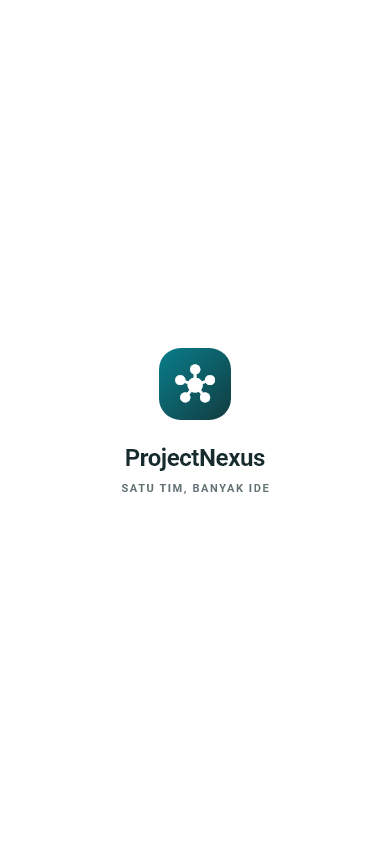
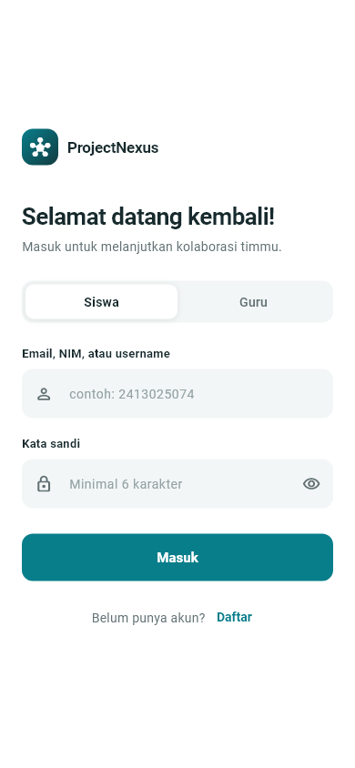
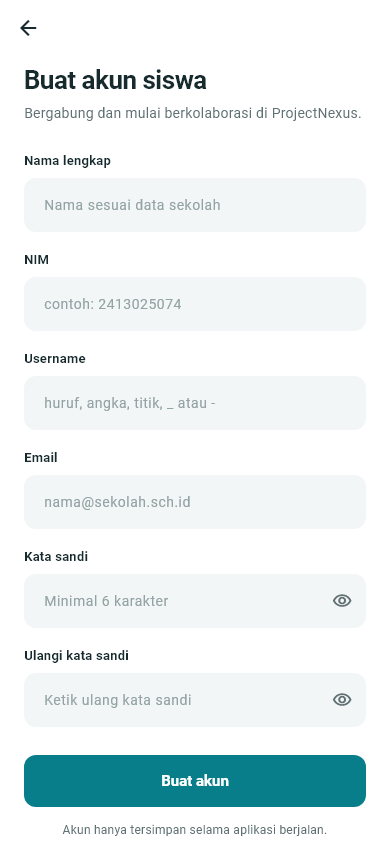
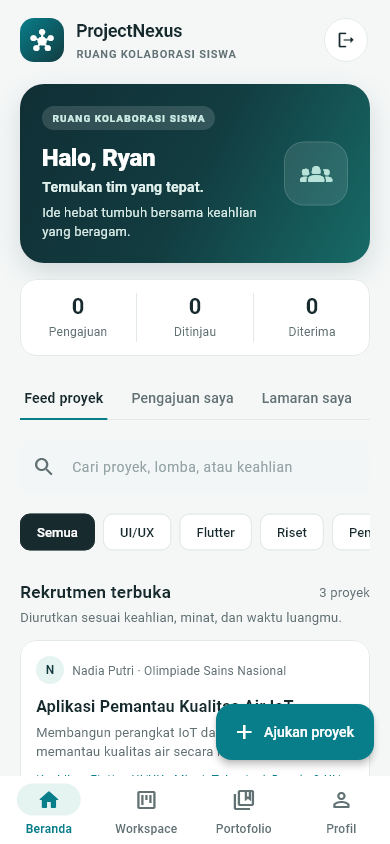
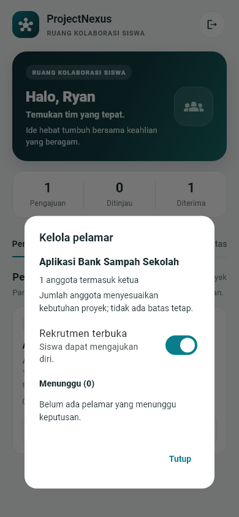
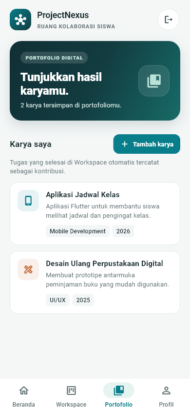
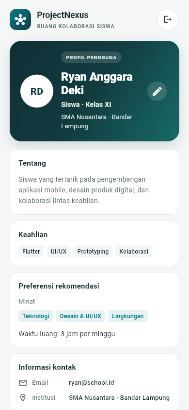

# ProjectNexus

**Platform Team-Matching & Inkubator Proyek Kolaborasi Lintas Keahlian Siswa**

Prototipe aplikasi mobile berbasis Flutter yang membantu siswa membentuk tim proyek lintas keahlian, dengan guru pendamping yang meninjau setiap ide proyek sebelum rekrutmen anggota dibuka.

| | |
|---|---|
| Mata kuliah | Mobile Programming (UTS – Proyek Mandiri) |
| Pengembang | Ryan Anggara Deki – 2413025074 – PTI 2024B |
| Program studi | Pendidikan Teknologi Informasi, Universitas Lampung |
| Platform | Flutter 3.47 (Dart 3.13), target Android dan web |

## Latar belakang

Siswa yang ingin ikut lomba atau membuat proyek sering kesulitan menemukan rekan dengan keahlian yang saling melengkapi. Tim biasanya dibentuk dari teman dekat sehingga keahliannya seragam, dan ide proyek belum tentu didampingi guru. ProjectNexus mempertemukan pemilik ide dengan siswa lain berdasarkan keahlian, mewajibkan persetujuan guru pendamping sebelum proyek dipublikasikan, dan menyediakan ruang kerja tim.

## Fitur utama

| Fitur | Keterangan |
|---|---|
| Login dua peran | Siswa masuk dengan email, NIM, atau username; guru dengan email sekolah. Siswa baru dapat mendaftar akun. |
| Pengajuan proyek | Siswa mengajukan draf proyek dan memilih guru pendamping. Draf berstatus *menunggu tinjauan*. |
| Persetujuan guru (ACC) | Hanya guru yang dipilih yang dapat menyetujui atau menolak draf disertai masukan. Siswa dapat merevisi lalu mengirim ulang. |
| Feed rekrutmen | Hanya proyek yang disetujui dan rekrutmennya terbuka yang tampil. Tersedia pencarian dan filter keahlian. |
| Rekomendasi & ramah pemula | Feed diurutkan berdasarkan kecocokan keahlian, minat, dan waktu luang. Proyek pemula diberi label, langkah pertama, dan perkiraan jam per minggu. |
| Lamaran & seleksi anggota | Siswa melamar sekali per proyek. Ketua menerima atau menolak pelamar dan dapat menutup rekrutmen. Jumlah anggota tidak dibatasi. |
| Workspace tim | Papan tugas To-Do, In Progress, dan Done yang hanya dapat dibuka anggota tim dan guru pendamping. |
| Portofolio & lencana | Tugas yang selesai tercatat otomatis sebagai kontribusi dan diberi lencana apresiasi. |
| Foto karya | Karya portofolio dapat diberi foto dari kamera atau galeri (pemilih berkas di browser). Foto diperkecil, dibatasi 2 MB, dan disimpan di database lokal. |
| Katalog prestasi & profil | Etalase prestasi sekolah serta profil yang dapat diedit (keahlian, minat, waktu luang). |
| Penyimpanan lokal | Proyek, lamaran, tugas Workspace, portofolio, dan akun siswa tersimpan di database lokal sehingga tetap ada setelah aplikasi ditutup. Kata sandi disimpan sebagai hash SHA-256. |

## Tangkapan layar

<table>
  <tr>
    <td align="center"><br>Splash</td>
    <td align="center"><br>Login</td>
    <td align="center"><br>Registrasi siswa</td>
    <td align="center"><br>Beranda siswa</td>
  </tr>
  <tr>
    <td align="center"><br>Detail proyek</td>
    <td align="center"><br>Ajukan proyek</td>
    <td align="center"><br>Antrean guru</td>
    <td align="center"><br>Kelola pelamar</td>
  </tr>
  <tr>
    <td align="center"><br>Workspace</td>
    <td align="center"><br>Portofolio</td>
    <td align="center"><br>Profil</td>
    <td></td>
  </tr>
</table>

Tampilan pada layar lebar (navigasi samping):


## Teknologi

- **Flutter** dan **Dart** dengan widget Material 3
- **ChangeNotifier** untuk state alur proyek dan lamaran (`ProjectWorkflowStore`)
- **Hive CE** sebagai database lokal (IndexedDB di browser, berkas di Android)
- **crypto** (SHA-256) untuk hash kata sandi akun siswa
- **image_picker** untuk mengambil foto karya dari kamera atau galeri
- **shared_preferences** untuk sesi login dan preferensi rekomendasi
- **flutter_test** untuk unit test dan widget test

## Struktur proyek

```
lib/
├── main.dart                     # titik masuk aplikasi
├── core/
│   ├── media/                    # pengambil foto kamera/galeri (PhotoPicker)
│   ├── storage/                  # database lokal (LocalDatabase)
│   └── theme/                    # warna dan tema terpusat (AppTheme)
└── features/
    ├── auth/                     # splash, login, registrasi, sesi (AuthGate)
    │   ├── models/  screens/  widgets/
    └── dashboard/                # beranda, workspace, portofolio, profil
        ├── data/                 # data contoh dan penyimpanan preferensi
        ├── models/               # model, aturan alur proyek, rekomendasi
        ├── screens/
        └── widgets/
test/                             # 19 unit test dan 25 widget test
docs/screenshots/                 # tangkapan layar untuk README
```

Aturan bisnis (siapa boleh mengajukan, meninjau, melamar, menerima anggota, dan membuka Workspace) dipusatkan di `lib/features/dashboard/models/project_workflow_store.dart`, sehingga dapat diuji tanpa antarmuka dan tidak bisa dilewati dari halaman mana pun.

## Cara menjalankan

**Prasyarat:** Flutter SDK 3.47 atau lebih baru, Google Chrome (target web), atau Android emulator / perangkat Android dengan JDK 17 (target Android).

```bash
git clone https://github.com/ryananggara123/Project_Nexus.git
cd Project_Nexus
flutter pub get

# menjalankan di Chrome
flutter run -d chrome

# menjalankan di Android emulator
flutter emulators --launch Pixel_6
flutter run
```

**Akun uji coba:**

| Peran | Cara masuk |
|---|---|
| Siswa | Daftar akun lewat tombol **Daftar**, lalu masuk dengan email, NIM, atau username dan kata sandi minimal 6 karakter. |
| Guru (Budi Santoso) | Pilih **Guru**, masukkan email sekolah apa pun yang valid, misalnya `budi@school.id`. |
| Guru (Siti Rahmawati) | Pilih **Guru**, masukkan `siti.rahmawati@school.id`. |

## Pengujian

```bash
flutter analyze   # analisis statis: No issues found
flutter test      # 44 pengujian: All tests passed
```

## Batasan prototipe

- Data tersimpan di database lokal pada masing-masing perangkat atau browser, sehingga belum tersinkron antarperangkat.
- Autentikasi masih lokal dan Firebase belum diintegrasikan, sehingga foto karya baru tersimpan di perangkat masing-masing.
- Prototipe ini belum ditujukan untuk menyimpan data siswa yang sensitif.

## Progres pasca-UTS

| Minggu | Pekerjaan | Status |
|---|---|---|
| 1 | Database lokal (Hive CE) untuk proyek, lamaran, tugas Workspace, portofolio, dan akun siswa, beserta hash kata sandi dan pengujian persistensi | Selesai |
| 2 | Unggah foto karya portofolio dari kamera atau galeri, disimpan di database lokal | Selesai |

## Rencana menuju UAS

1. Integrasi backend sesuai PRD: Firebase Authentication, Cloud Firestore untuk proyek, lamaran, dan tugas, serta Firebase Storage untuk foto karya. Database lokal dipertahankan sebagai cache saat offline.
2. Notifikasi push untuk guru (draf baru) dan ketua proyek (pelamar baru).
3. Pengujian pada emulator dan perangkat Android fisik, termasuk kamera.

## Penggunaan AI

Pengembangan aplikasi ini dibantu asisten AI. Rincian alat, pembagian peran, dan contoh prompt dijelaskan di [AI_DECLARATION.md](AI_DECLARATION.md).
