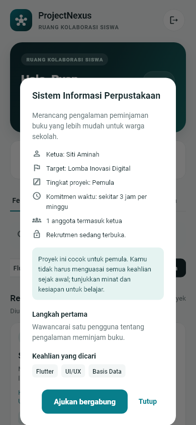
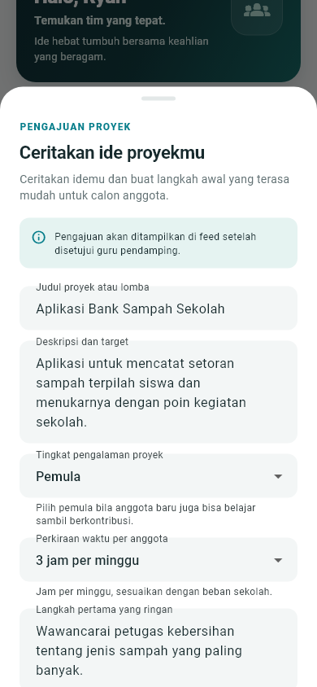
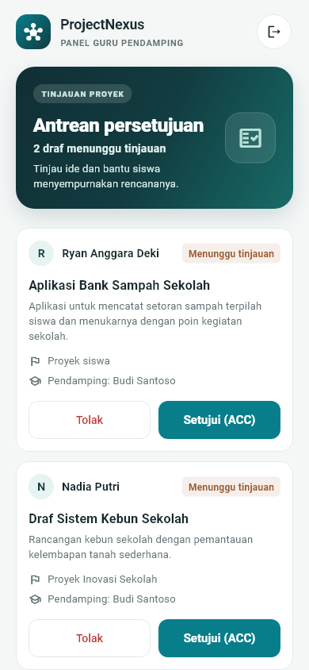
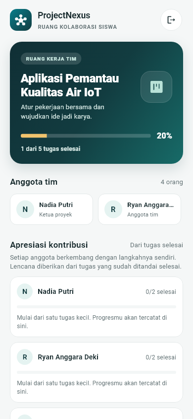
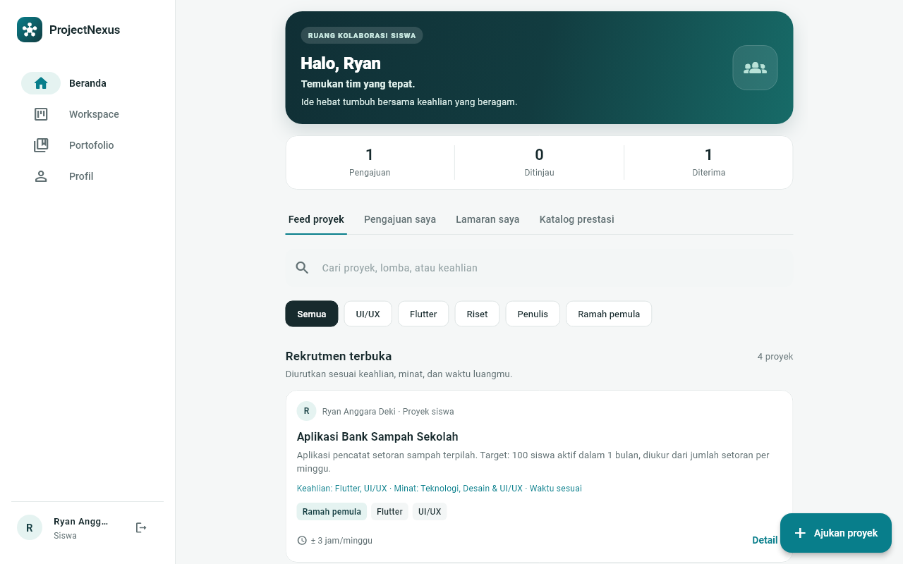

# ProjectNexus

**Platform Team-Matching & Inkubator Proyek Kolaborasi Lintas Keahlian Siswa**

Prototipe aplikasi mobile berbasis Flutter yang membantu siswa membentuk tim proyek lintas keahlian, dengan guru pendamping yang meninjau setiap ide proyek sebelum rekrutmen anggota dibuka.

| | |
|---|---|
| Mata kuliah | Mobile Programming (UTS – Proyek Mandiri) |
| Pengembang | Ryan Anggara Deki – 2413025074 – PTI 2024B |
| Program studi | Pendidikan Teknologi Informasi, Universitas Lampung |
| Platform | Flutter 3.47 (Dart 3.13), target Android dan web |

## Latar belakang

Siswa yang ingin ikut lomba atau membuat proyek sering kesulitan menemukan rekan dengan keahlian yang saling melengkapi. Tim biasanya dibentuk dari teman dekat sehingga keahliannya seragam, dan ide proyek belum tentu didampingi guru. ProjectNexus mempertemukan pemilik ide dengan siswa lain berdasarkan keahlian, mewajibkan persetujuan guru pendamping sebelum proyek dipublikasikan, dan menyediakan ruang kerja tim.

## Fitur utama

| Fitur | Keterangan |
|---|---|
| Login dua peran (Firebase) | Akun disimpan di Firebase Authentication. Siswa masuk dengan email, NIM, atau username; guru dengan email sekolah. Siswa baru dapat mendaftar, sedangkan akun guru dibuat administrator. Sesi login tetap tersimpan setelah aplikasi ditutup. |
| Pengajuan proyek | Siswa mengajukan draf proyek dan memilih guru pendamping. Draf berstatus *menunggu tinjauan*. |
| Persetujuan guru (ACC) | Hanya guru yang dipilih yang dapat menyetujui atau menolak draf disertai masukan. Siswa dapat merevisi lalu mengirim ulang. |
| Feed rekrutmen | Hanya proyek yang disetujui dan rekrutmennya terbuka yang tampil. Tersedia pencarian dan filter keahlian. |
| Rekomendasi & ramah pemula | Feed diurutkan berdasarkan kecocokan keahlian, minat, dan waktu luang. Proyek pemula diberi label, langkah pertama, dan perkiraan jam per minggu. |
| Lamaran & seleksi anggota | Siswa melamar sekali per proyek. Ketua menerima atau menolak pelamar dan dapat menutup rekrutmen. Jumlah anggota tidak dibatasi. |
| Workspace tim | Papan tugas To-Do, In Progress, dan Done yang hanya dapat dibuka anggota tim dan guru pendamping. Tugas dapat ditambah, dipindah, diedit, dan dihapus. |
| Portofolio & lencana | Tugas yang selesai tercatat otomatis sebagai kontribusi dan diberi lencana apresiasi. |
| Foto karya | Karya portofolio dapat diberi foto dari kamera atau galeri (pemilih berkas di browser). Foto diperkecil, dibatasi 700 KB, lalu disimpan di database lokal dan di Firestore sehingga tampil di semua perangkat. Karya milik sendiri dapat diedit (termasuk mengganti atau menghapus foto) dan dihapus. |
| Katalog prestasi & profil | Etalase prestasi sekolah serta profil yang dapat diedit (keahlian, minat, waktu luang). |
| Sinkronisasi realtime | Proyek, lamaran, tugas Workspace, dan notifikasi disimpan di Cloud Firestore dan langsung muncul di perangkat lain tanpa memuat ulang. Database lokal (Hive) tetap menyimpan salinan sebagai cache offline. |
| Pusat notifikasi | Lonceng dengan lencana jumlah belum dibaca. Guru diberi tahu saat ada draf atau revisi baru; siswa saat proyeknya disetujui atau ditolak, ada pelamar baru, lamarannya diputuskan, atau mendapat tugas baru. Notifikasi yang tiba saat aplikasi terbuka muncul sebagai pesan singkat; di Android, notifikasi yang tiba saat aplikasi di latar belakang muncul di bilah notifikasi HP. |
| Aturan keamanan | `firestore.rules` membatasi akses sesuai peran: hanya pengguna yang masuk yang dapat membaca data, siswa tidak dapat menyetujui proyek atau mengubah perannya, dan notifikasi hanya dapat dibaca penerimanya. |
| Mode lokal | Bila Firebase tidak tersedia (misalnya Windows desktop), aplikasi tetap berjalan dengan akun dan data di database lokal. Kata sandi akun lokal disimpan sebagai hash SHA-256. |

## Tangkapan layar

<table>
  <tr>
    <td align="center"><br>Splash</td>
    <td align="center"><br>Login</td>
    <td align="center"><br>Registrasi siswa</td>
    <td align="center"><br>Beranda siswa</td>
  </tr>
  <tr>
    <td align="center"><br>Detail proyek</td>
    <td align="center"><br>Ajukan proyek</td>
    <td align="center"><br>Antrean guru</td>
    <td align="center"><br>Kelola pelamar</td>
  </tr>
  <tr>
    <td align="center"><br>Workspace</td>
    <td align="center"><br>Portofolio</td>
    <td align="center"><br>Profil</td>
    <td></td>
  </tr>
</table>

Tampilan pada layar lebar (navigasi samping):



## Teknologi

- **Flutter** dan **Dart** dengan widget Material 3
- **ChangeNotifier** untuk state alur proyek dan lamaran (`ProjectWorkflowStore`)
- **Firebase Authentication** untuk akun siswa dan guru
- **Cloud Firestore** untuk data bersama yang tersinkron realtime, dilindungi `firestore.rules`
- **Hive CE** sebagai database lokal dan cache offline (IndexedDB di browser, berkas di Android)
- **crypto** (SHA-256) untuk hash kata sandi akun siswa
- **image_picker** untuk mengambil foto karya dari kamera atau galeri
- **flutter_local_notifications** untuk notifikasi sistem Android
- **shared_preferences** untuk sesi login dan preferensi rekomendasi
- **flutter_test** untuk unit test dan widget test

## Struktur proyek

```
lib/
├── main.dart                     # titik masuk: membuka Hive dan menghubungkan Firebase
├── firebase_options.dart         # konfigurasi Firebase (dibuat FlutterFire CLI)
├── core/
│   ├── cloud/                    # CloudStore: Firestore dan versi memori untuk pengujian
│   ├── media/                    # pengambil foto kamera/galeri (PhotoPicker)
│   ├── storage/                  # database lokal (LocalDatabase)
│   └── theme/                    # warna dan tema terpusat (AppTheme)
└── features/
    ├── auth/                     # splash, login, registrasi, sesi (AuthGate)
    │   ├── data/                 # layanan akun: lokal dan Firebase
    │   ├── models/  screens/  widgets/
    ├── dashboard/                # beranda, workspace, portofolio, profil
    │   ├── data/                 # data contoh dan penyimpanan preferensi
    │   ├── models/               # model, aturan alur proyek, rekomendasi
    │   ├── screens/
    │   └── widgets/
    └── notifications/            # model, penyimpanan, dan pusat notifikasi
test/                             # 46 unit test dan 30 widget test
firestore.rules                   # aturan keamanan Cloud Firestore
docs/screenshots/                 # tangkapan layar untuk README
```

Aturan bisnis (siapa boleh mengajukan, meninjau, melamar, menerima anggota, dan membuka Workspace) dipusatkan di `lib/features/dashboard/models/project_workflow_store.dart`, sehingga dapat diuji tanpa antarmuka dan tidak bisa dilewati dari halaman mana pun.

## Cara menjalankan

**Prasyarat:** Flutter SDK 3.47 atau lebih baru, Google Chrome (target web), atau Android emulator / perangkat Android dengan JDK 17 (target Android).

```bash
git clone https://github.com/ryananggara123/Project_Nexus.git
cd Project_Nexus
flutter pub get

# menjalankan di Chrome
flutter run -d chrome

# menjalankan di Android emulator
flutter emulators --launch Pixel_6
flutter run
```

Konfigurasi Firebase (`lib/firebase_options.dart` dan `android/app/google-services.json`) sudah disertakan untuk proyek Firebase `project-nexus-3477f`. Untuk memakai proyek Firebase sendiri, jalankan `flutterfire configure`, aktifkan login Email/Password, buat Cloud Firestore, lalu terapkan aturan keamanan dengan `firebase deploy --only firestore:rules`.

**Akun uji coba:**

| Peran | Cara masuk |
|---|---|
| Siswa | Daftar akun lewat tombol **Daftar**, lalu masuk dengan email, NIM, atau username dan kata sandi minimal 6 karakter. |
| Guru (Budi Santoso) | Pilih **Guru**, masuk dengan `budi.santoso@school.id` dan kata sandi `guru12345`. |
| Guru (Siti Rahmawati) | Pilih **Guru**, masuk dengan `siti.rahmawati@school.id` dan kata sandi `guru12345`. |

Untuk melihat sinkronisasi realtime, buka aplikasi di dua jendela browser (misalnya satu jendela biasa dan satu jendela penyamaran), lalu masuk sebagai siswa di satu jendela dan sebagai guru di jendela lainnya.

## Pengujian

```bash
flutter analyze   # analisis statis: No issues found
flutter test      # 76 pengujian: All tests passed
```

## Batasan prototipe

- Foto karya disimpan sebagai base64 di Firestore (bukan Firebase Storage yang memerlukan paket Blaze berbayar), sehingga ukurannya dibatasi 700 KB.
- Notifikasi sistem Android tampil selama aplikasi masih berjalan di latar belakang; notifikasi push saat aplikasi ditutup sepenuhnya memerlukan server (Cloud Functions) dan belum tersedia.
- Karya contoh milik siswa fiktif tidak tersinkron ke server karena aturan keamanan hanya mengizinkan pemilik karya mengunggahnya.
- Papan tugas satu proyek disimpan sebagai satu dokumen. Bila dua anggota mengubahnya pada saat yang sama, perubahan terakhir yang dipakai.
- Pengguna dikenali lewat nama lengkap di data proyek, sehingga nama siswa sebaiknya unik.
- Prototipe ini belum ditujukan untuk menyimpan data siswa yang sensitif.

## Progres pasca-UTS

| Minggu | Pekerjaan | Status |
|---|---|---|
| 1 | Database lokal (Hive CE) untuk proyek, lamaran, tugas Workspace, portofolio, dan akun siswa, beserta hash kata sandi dan pengujian persistensi | Selesai |
| 2 | Unggah foto karya portofolio dari kamera atau galeri, disimpan di database lokal | Selesai |
| 3–4 | Firebase Authentication dan sinkronisasi realtime Cloud Firestore dengan aturan keamanan, pusat notifikasi, edit dan hapus karya portofolio dan tugas Workspace, sinkronisasi karya beserta fotonya, dan notifikasi sistem Android | Selesai |

## Rencana menuju UAS

1. Pengujian pada HP Android fisik, termasuk kamera, notifikasi sistem, dan sinkronisasi antara HP dan browser.
2. Pengujian penerimaan bersama pengguna (siswa dan guru) serta perbaikan berdasarkan masukan.
3. Penyempurnaan tampilan dan aksesibilitas.
4. Persiapan presentasi dan dokumentasi akhir UAS.

## Penggunaan AI

Pengembangan aplikasi ini dibantu asisten AI. Rincian alat, pembagian peran, dan contoh prompt dijelaskan di [AI_DECLARATION.md](AI_DECLARATION.md).
